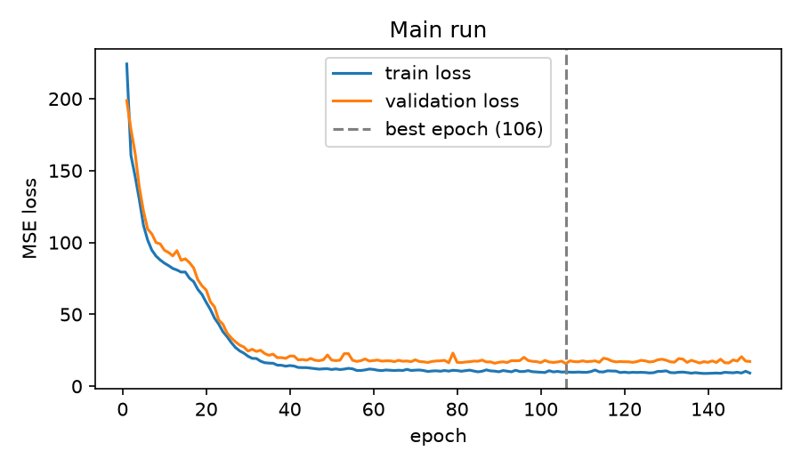
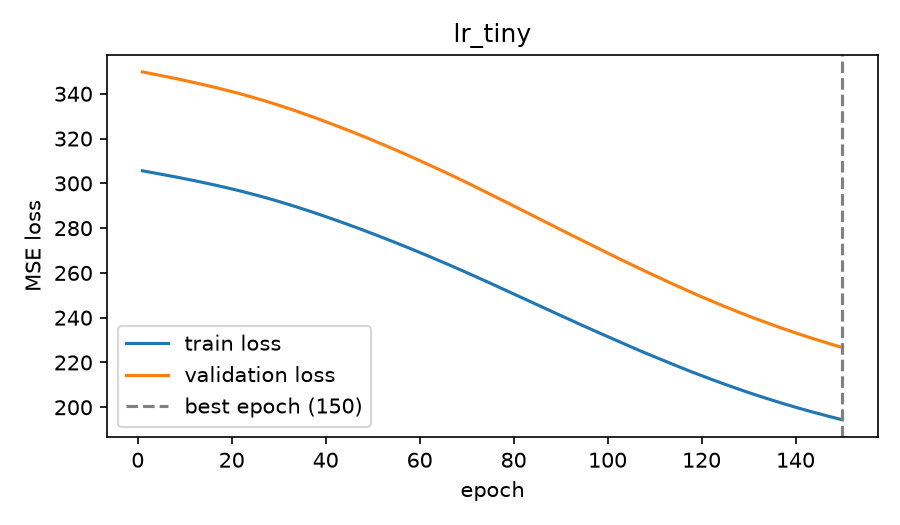
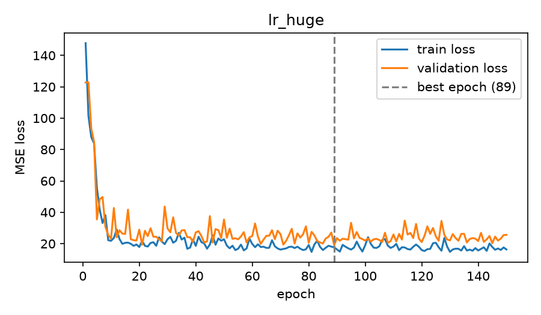

# Lakeshore Bike Demand

## What it does

This project predicts how many bikes will be rented from a station in one hour, from the hour, the weather, the day type and the station type. It trains a small PyTorch network with a hand-written training loop and compares it with two simple baselines: the training mean and a linear regression.

## How to run it

```bash
conda env create -f environment.yml
conda activate lab07-first-principles
python train.py
python -m pytest
python -m ruff format --check .
python -m ruff check .
```

The repository is named `aigc5005-lab07-first-principles` instead of
`lab07-first-principles`; the files and the layout are the same.

## Data and split

`bikes_data.py` builds 6,000 station-hours. The rows are split 60/20/20 into training (3,600), validation (1,200) and test (1,200) rows with `train_test_split` and `random_state=42`, before any preparation.

The five numeric columns are standardised with `StandardScaler` and `station_type` is one-hot encoded, giving 8 features. Both are fitted on the training rows only and then applied to the validation and test rows, so no information from those rows leaks into training. All settings were chosen on the validation rows; the test rows were used once, at the end.

## Model and training

- **Network** (`model.py`): 8 inputs → 64 → ReLU → 64 → ReLU → 1 output, with no activation at the end, because the target is a count, not a probability.
- **Loss**: mean squared error (MSE). The mean absolute error (MAE) is reported because it is easier to read.
- **Optimizer**: Adam, learning rate 3e-3.
- **Batches**: 64 rows; only the training loader is shuffled.
- **Epochs**: 150. After training, the weights of the epoch with the lowest validation loss are put back (epoch 106).
- **Seeds**: `torch.manual_seed(42)` and a seeded `torch.Generator` for the training DataLoader, set in `train.py`. Running `python train.py` twice on the same computer gives identical numbers.

## Results

Mean absolute error, in rentals (lower is better):

| Model | Validation MAE | Test MAE |
|---|---|---|
| Training mean | 10.15 | 9.65 |
| Linear regression | 9.32 | 8.57 |
| **Network** | **2.63** | **2.44** |

The network's error is about a quarter of the baselines' errors. The linear model does barely better than the mean because rentals do not rise in a straight line with the hour: weekdays have two commute peaks (around 8:00 and 17:30), weekends have one midday peak, and park stations behave the opposite way to downtown stations. A straight line cannot bend to follow these peaks or change shape with the day and the station type.



Both losses fall quickly in the first epochs (validation loss 199 at epoch 1) and then flatten. The validation loss is lowest at epoch 106 (15.7). After that the training loss keeps falling slowly while the validation loss creeps up, the first sign of overfitting, which is why the best weights are put back (numbers from `reports/history.csv`).

## Experiments

Each run changes one setting from the main run, with the same seed.

| Run | Change | Best epoch | Best val MAE | Final train loss | Final val loss |
|---|---|---|---|---|---|
| main | none | 106 | 2.63 | 9.20 | 17.23 |
| lr_tiny | learning rate 3e-3 → 1e-5 | 150 | 9.25 | 194.38 | 226.67 |
| lr_huge | learning rate 3e-3 → 1e-1 | 89 | 2.96 | 16.32 | 25.63 |
| wide | hidden size 64 → 1024 | 26 | 2.61 | 5.41 | 21.55 |


- **lr_tiny – underfitting.** Both losses are still high and still falling at the last epoch, so the best epoch is the last one. The steps are too small to learn anything in 150 epochs; its MAE is no better than the linear model.  


- **lr_huge – unstable.** The curves are jagged and jump up and down, because each step is too large and overshoots. It ends worse than the main run.  


- **wide – overfitting.** With about 1.06 million weights instead of about 4,800, it reaches its best validation loss already at epoch 26. After that the training loss keeps falling while the validation loss rises (to 21.6): it memorises the training rows. Its best MAE (2.61) is almost the same as the main run's, so the smaller network is kept.  


- **main – fine.** Both losses fall together and only drift apart slightly at the end.

## Limitations

- The data are invented by `bikes_data.py`, not taken from a real city. The model has learned the rules of that generator, not real riders.
- It sees only six columns. It does not know the date, season, holidays, events, the rentals in the previous hour or how many bikes are actually in the dock, so it cannot predict demand that bikes were not there to meet.
- It gives one number with no range of uncertainty.
- A planner should not use it to move bikes in a real city without retraining and testing it on real data from that city.
